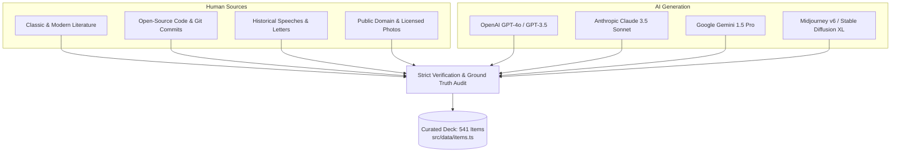
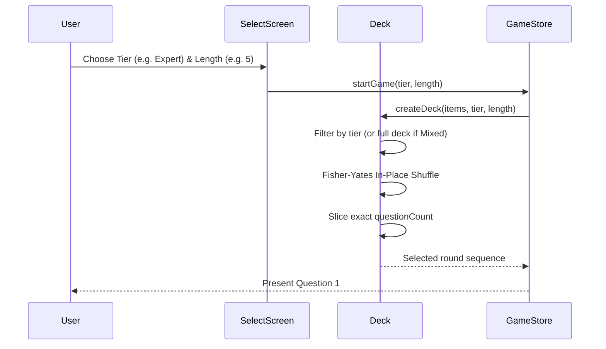
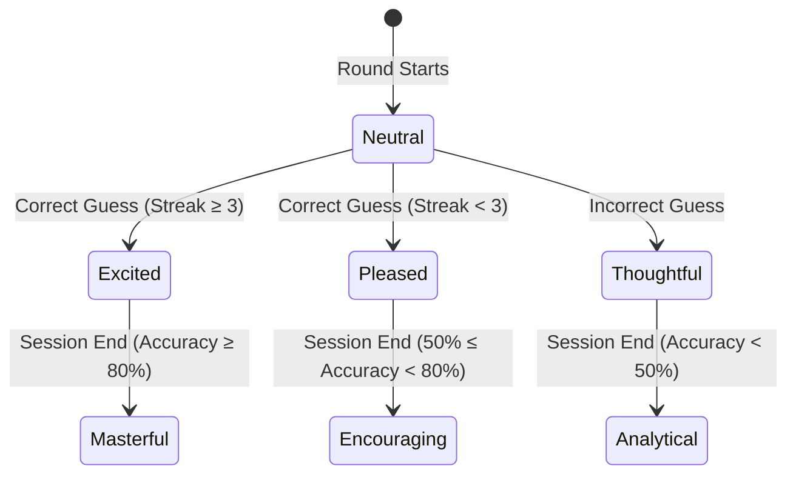
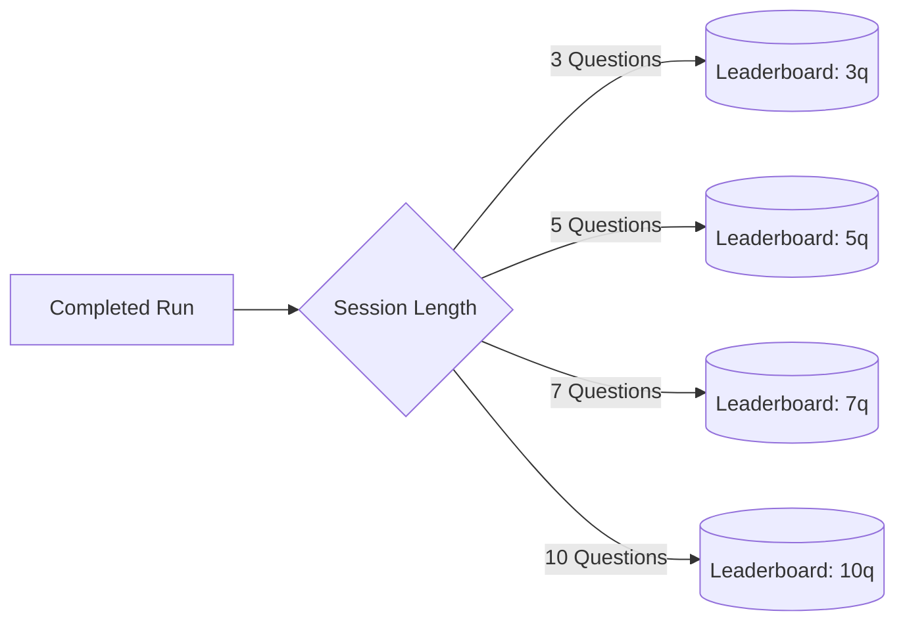

# Methodology

How **Real or AI?** selects, verifies, and scores human vs. AI content: where the items come from, how difficulty tiers are calibrated, how the deck randomization works, how scoring and streak multipliers are calculated, and how kiosk offline reliability is guaranteed.

Every algorithm and state machine described here is implemented in `src/game/`, `src/data/`, `src/character/`, and `src/leaderboard/`.

[← Back to README](./README.md)

---

## Contents

1. [Item Bank & Content Provenance](#1-item-bank--content-provenance)
2. [Difficulty Tier Calibration](#2-difficulty-tier-calibration)
3. [Concept Taxonomy & Field Guide](#3-concept-taxonomy--field-guide)
4. [Deck Randomization & Dealing](#4-deck-randomization--dealing)
5. [Scoring Formula & Streak Multipliers](#5-scoring-formula--streak-multipliers)
6. [Signal Persona State Engine](#6-signal-persona-state-engine)
7. [Kiosk Lifecycle & Idle Watchdog](#7-kiosk-lifecycle--idle-watchdog)
8. [Audio Synthesis via Web Audio API](#8-audio-synthesis-via-web-audio-api)
9. [Leaderboard Storage & Data Separation](#9-leaderboard-storage--data-separation)
10. [Limitations & Ethical Disclosures](#10-limitations--ethical-disclosures)

---

## 1. Item Bank & Content Provenance

The application contains **541 curated items** spanning both textual and visual mediums.



### Ground Truth Integrity
- **Zero Synthetic Guessing:** Every item has an immutable ground-truth label (`isAi: true` or `isAi: false`).
- **Human Provenance:** Human text is extracted from published literature, verified historical archives, open-source repositories, and documented public exchanges. Human images are curated with public domain or creative commons licensing (see `src/assets/images/SOURCES.md`).
- **AI Provenance:** AI text and images are generated using frontier LLMs and diffusion models with explicit prompt logging to document synthetic signatures.

---

## 2. Difficulty Tier Calibration

Items are partitioned into four difficulty tiers to create a balanced progression for kiosk visitors:

| Tier | Item Count | Human/AI Balance | Defining Characteristics |
| :--- | :---: | :---: | :--- |
| **Novice** | 26 | 50% / 50% | Obvious stylistic giveaways: high cliché density, blatant hallucinations, robotic repetition, or visible diffusion rendering artifacts. |
| **Keen** | 182 | 50% / 50% | Intermediate difficulty: syntactically clean text with subtle unnatural cadence, or clean imagery with minor lighting/shadow inconsistencies. |
| **Expert** | 182 | 50% / 50% | High fidelity: natural human quirks, nuanced reasoning, idiomatic open-source code, and convincing photorealism. |
| **Master** | 151 | ~50% / 50% | Frontier Turing challenge: indistinguishable synthetic prose, highly irregular human writing styles, and flawless visual composition. |

---

## 3. Concept Taxonomy & Field Guide

Each item is annotated with a pedagogical concept tag from the 36-concept Field Guide glossary (`src/character/fieldGuide.ts`):

```text
Concept Tag Categories:
├── Stylistic Signatures (cliche-density, formal-uniformity, emotional-flatness)
├── Structural Markers (code-symmetry, syntactic-padding, transition-overuse)
├── Cognitive Artifacts (hallucinated-jargon, surface-coherence, false-authority)
└── Visual Artifacts (synthetic-smoothness, lighting-incoherence, anatomical-drift)
```

When a visitor answers a round, the reveal screen (`src/components/RevealedPanel.tsx`) displays the specific concept tag and actionable diagnostic explanation associated with that round.

---

## 4. Deck Randomization & Dealing

The deck-dealing algorithm ensures fair, non-repeating rounds for each session:



1. **Filtering:** Filters the 541 items down to the selected tier (or includes all tiers if "Mixed" is selected).
2. **Fisher-Yates Shuffle:** Performs an unbiased in-place shuffle using cryptographic-grade randomness where available, falling back to `Math.random()`.
3. **No Repeats:** Slices the first $N$ items ($N \in \{3, 5, 7, 10\}$), guaranteeing that a visitor never sees duplicate items within a single session.
4. **Stress Testing:** Validated via automated Monte Carlo simulation across 10,000 consecutive draws without indexing errors or distribution anomalies (`src/game/simulation.test.ts`).

---

## 5. Scoring Formula & Streak Multipliers

The scoring engine calculates points dynamically based on accuracy, difficulty weight, and continuous streaks:

$$\text{Points}_{\text{round}} = \text{Base} \times \text{TierMultiplier} \times \text{StreakMultiplier}$$

### Streak Multiplier Schedule

$$\text{StreakMultiplier} = \begin{cases} 
1.0\times & \text{streak} = 1 \\
1.5\times & \text{streak} = 2 \\
2.0\times & \text{streak} = 3 \\
2.5\times & \text{streak} = 4 \\
3.0\times & \text{streak} \ge 5 
\end{cases}$$

An incorrect answer resets the active streak counter to zero immediately, testing consistency under pressure.

---

## 6. Signal Persona State Engine

**Signal** is the resident forensic pattern reader who accompanies the player. Signal's reaction state machine transitions dynamically based on player performance:



Signal's avatar and speech bubbles provide immediate, non-judgmental pedagogical reinforcement after every single guess.

---

## 7. Kiosk Lifecycle & Idle Watchdog

To operate autonomously on a public kiosk screen without operator intervention, the application runs a non-intrusive idle watchdog (`src/hooks/idle.ts`):

- **Event Listeners:** Tracks `pointerdown`, `mousemove`, `keydown`, `touchstart`, and `wheel`.
- **45-Second Watchdog Timer:** If no user input occurs for 45 consecutive seconds during gameplay, select, or stats screens, the watchdog triggers an automated cleanup:
  1. Aborts any in-flight round state.
  2. Clears temporary visitor name inputs.
  3. Transitions smoothly back to the high-contrast `AttractScreen`.
- **Debounced Double-Click Guard:** Hardware touchscreens frequently register erratic double-taps. Guess buttons are locked immediately upon the first trigger to prevent accidental multi-guessing.

---

## 8. Audio Synthesis via Web Audio API

To eliminate external audio asset dependencies and avoid network latency or 404 audio errors, sound effects are generated dynamically via the **Web Audio API** (`src/audio/tone.ts`):

- **Correct Chime:** Dual harmonic sine wave ($587.33\,\text{Hz} \to 880\,\text{Hz}$ / $D_5 \to A_5$) with exponential decay.
- **Incorrect Thud:** Low triangle/sawtooth frequency ($180\,\text{Hz} \to 110\,\text{Hz}$) with lowpass filtering.
- **Toggle State:** Persistent sound toggle stored in application state (shortcut: `M` key).

---

## 9. Leaderboard Storage & Data Separation

Session scores are strictly segregated by session length to preserve competitive fairness:



- **Fairness Guarantee:** A 3-question session is never pitted against a 10-question session.
- **LocalStorage Resilience:** Entries are safely serialized into JSON with schema versioning. In the event of storage quota exhaustion or private browsing restrictions, an in-memory fallback prevents runtime crashes.
- **Export Formats:**
  - Tab-separated `.txt` export containing timestamp, player name, tier, score, accuracy, and streak.
  - Dedicated printable CSS takeaway stylesheet formatted for standard 8.5x11 / A4 stall handouts.

---

## 10. Limitations & Ethical Disclosures

- **Rapid LLM Evolution:** AI models improve continuously. Heuristics that identify synthetic text today may become less distinct in subsequent foundation model releases.
- **Educational Scope:** This tool is designed to train human close-reading, cognitive vigilance, and pattern recognition. It is not an automated forensic detector and should not be used as an authoritative plagiarism or fraud detection engine.
- **Subjectivity in Aesthetic Judgment:** Creative writing and abstract visual art span extreme ranges of human expression; unconventional human works may intentionally mimic rigid or repetitive structures.
