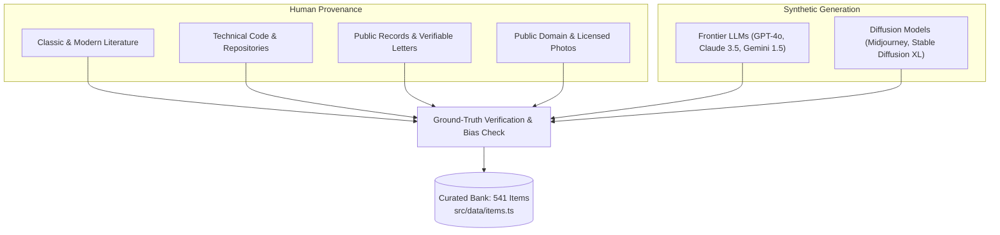
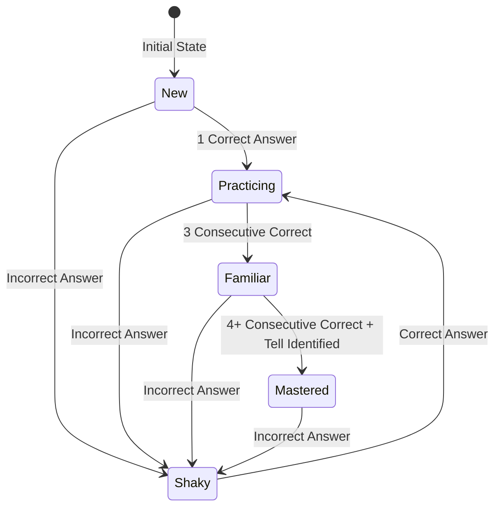

# Methodology

How **TuringWall** (*Real or AI?*) selects, verifies, and scores human vs. AI content: where items originate, how difficulty tiers and scoring points are weighted, how confidence calibration and spaced repetition mastery operate, and how privacy and local data separation are guaranteed.

Every algorithm and state machine described here is implemented in `src/game/`, `src/learning/`, `src/character/`, `src/prefs/`, and `src/leaderboard/`.

[← Back to README](./README.md)

---

## Contents

1. [Item Bank & Ground Truth Provenance](#1-item-bank--ground-truth-provenance)
2. [Difficulty Tiers & Item Taxonomy](#2-difficulty-tiers--item-taxonomy)
3. [Scoring Formula, Tells & Calibration](#3-scoring-formula-tells--calibration)
4. [Mastery Tiers & Spaced Review Intervals](#4-mastery-tiers--spaced-review-intervals)
5. [Deck Selection & Daily Challenge Variety](#5-deck-selection--daily-challenge-variety)
6. [Preferences, Privacy & Data Persistence](#6-preferences-privacy--data-persistence)
7. [Leaderboard Record Schema & Legacy Fallbacks](#7-leaderboard-record-schema--legacy-fallbacks)
8. [Session History: Completed vs. Abandoned](#8-session-history-completed-vs-abandoned)
9. [Signal Persona State Engine](#9-signal-persona-state-engine)
10. [Limitations & Pedagogical Disclosures](#10-limitations--pedagogical-disclosures)

---

## 1. Item Bank & Ground Truth Provenance

The application contains **541 curated items** spanning text excerpts and visual images.



### Ground Truth Integrity
- **Immutable Ground Truth:** Every item carries a binary ground truth (`isAI: true` or `isAI: false`).
- **Human Provenance:** Human texts originate from published authors, verified historical documents, or documented exchanges. Human images have verified licenses listed in `src/assets/images/SOURCES.md`.
- **Educational Principle:** *No single signal proves whether something is human or AI-made.* Explanations frame heuristics as clues, indicators, or tendencies rather than definitive proofs.

---

## 2. Difficulty Tiers & Item Taxonomy

Items are categorized into four difficulty tiers (`src/data/types.ts`):

| Tier | Item Count | Points Base | Defining Characteristics |
| :--- | :---: | :---: | :--- |
| **Easy** | 135 | +1 pt | Noticeable stylistic giveaways: high cliché density, formulaic cadence, or obvious visual artifacts. |
| **Medium** | 142 | +2 pts | Moderate challenge: syntactically clean text with subtle unnatural uniformity or minor rendering quirks. |
| **Hard** | 136 | +3 pts | High fidelity: natural human idiosyncrasies, authentic reasoning, or convincing synthetic realism. |
| **Pro** | 128 | +5 pts | Frontier Turing challenge: indistinguishable synthetic prose, highly irregular human writing styles, and nuanced logic. |

---

## 3. Scoring Formula, Tells & Calibration

Scoring decouples raw points from inquiry quality, rewarding accurate confidence assessment and clue identification:

### Points Breakdown
- **Correct Prediction by Tier:**
  - Easy: **+1 point**
  - Medium: **+2 points**
  - Hard: **+3 points**
  - Pro: **+5 points**
- **High-Confidence Bonus:** **+1 bonus point** when answering correctly with `high` confidence.
- **Tell Identification Credit:** **+1 partial point** when correctly identifying the underlying clue/tell, even if the primary source guess was incorrect.
- **Unsure Option:** **+1 safe point** without penalty; does **not** break an active streak.
- **Streak Penalty:** An incorrect non-unsure answer resets the current streak to `0`. Streak milestones at `[3, 5, 8, 12]` trigger celebrations (suppressed when reduced motion is preferred).

### Confidence Calibration Index (0–100)
Calibration evaluates metacognitive judgment (whether confidence matches outcome) via `calculateCalibrationScore` in `src/game/scoring.ts`:
- **High Confidence + Correct:** 100 (well-calibrated conviction)
- **High Confidence + Incorrect:** 10 (misled by deceptive surface cues)
- **Medium Confidence + Correct:** 85; **Medium + Incorrect:** 45
- **Low Confidence + Correct:** 70; **Low + Incorrect:** 65
- **Unsure Choice:** 80 (appropriate awareness of ambiguity)

The overall calibration score is the arithmetic mean across all rounds in the session.

---

## 4. Mastery Tiers & Spaced Review Intervals

Every concept in the 36-concept Field Guide (`src/character/fieldGuide.ts`) is tracked in the player's personal mastery map (`src/learning/mastery.ts`):



### Spaced Review Intervals (`calculateNextReviewTime`)
Review intervals are scheduled dynamically from the timestamp of the round:
- **After an Incorrect Answer:** Scheduled for review in **12 hours** (`+0.5 days`).
- **After a Correct Answer (by tier):**
  - `shaky`: **1 day**
  - `practicing`: **2 days**
  - `familiar`: **5 days**
  - `mastered`: **14 days**
  - `new`: **1 day**

Concepts are flagged as due for review if `tier === 'shaky'` or `nextReview <= Date.now()`.

---

## 5. Deck Selection & Daily Challenge Variety

### Deck Selectors
1. **Standard Sessions:** Filter items by chosen difficulty tier (`easy`, `medium`, `hard`, `pro`, or `mixed`) and shuffle without duplicate questions using a no-repeat deck.
2. **Practice Weak Tells (`selectWeakTellsDeck`):** Selects questions matching concepts where the player is currently `shaky` or has low accuracy, backfilling with broader items if needed.
3. **Review Missed Rounds (`selectMissedQuestionsDeck`):** Pulls directly from the player's missed questions queue (`real-or-ai-wall:missed-questions:v2`).
4. **Daily Challenge (`selectDailyChallengeDeck`):** Exactly 5 rounds structured as:
   - **Up to 3 review items** (due or shaky concepts).
   - **Up to 2 new items** (concepts not yet practiced).
   - **Variety Algorithm:** Never serves the exact item IDs most recently missed when an alternative item exists for that concept. When selecting an alternative, it prioritizes items with a different `kind` (image vs. text) or `category` than the missed item. If a concept only contains a single item in total, it falls back gracefully to that item.

---

## 6. Preferences, Privacy & Data Persistence

All data is stored purely in the user's browser `localStorage`:

| Storage Key | Owner | Contents |
| :--- | :--- | :--- |
| `real-or-ai-wall:prefs:v1` | `src/prefs/prefs.ts` | Schema: `{ version: 1, sound: boolean, motion: 'system' \| 'reduce' \| 'full', showNameOnLeaderboard: boolean }` |
| `real-or-ai-wall:sessions:v1` | `src/learning/sessions.ts` | Session history array capped at 200 records (`completed` vs `abandoned`). |
| `real-or-ai-wall:leaderboard:v2` | `src/leaderboard/leaderboard.ts` | Leaderboard entries segregated by session length (`3`, `5`, `7`, `10`). |
| `real-or-ai-wall:mastery:v2` | `src/learning/mastery.ts` | Dictionary of all 36 concepts mapped to `ConceptMastery`. |
| `real-or-ai-wall:missed-questions:v2` | `src/learning/mastery.ts` | Array of item IDs currently queued for review. |

### Privacy Controls
- **Anonymous by Default:** Players can leave the name field blank to record runs as "Anonymous".
- **Name Privacy Toggle:** When `showNameOnLeaderboard` is disabled, player names are omitted from share summaries and print takeaways.
- **Device Attribution:** Device aggregate metrics are strictly labeled "This device" rather than "Community" or "Global".

---

## 7. Leaderboard Record Schema & Legacy Fallbacks

Each leaderboard record follows the `LeaderboardEntry` interface:

```ts
interface LeaderboardEntry {
  name: string;
  difficulty: SessionMode;
  score: number;
  accuracy: number;
  bestStreak: number;
  timestamp: number;
  roundsTarget: SessionLength;
  calibration?: number;
  tellAccuracy?: number;
  conceptsMastered?: number;
  completed?: boolean;
}
```

### Legacy Record Compatibility
To guarantee backward compatibility when reading records saved by older versions:
- `calibration`: Defaults to `entry.calibration ?? entry.accuracy`.
- `conceptsMastered`: Defaults to `entry.conceptsMastered ?? 0`.
- `completed`: Evaluated as `entry.completed !== false` (legacy unflagged entries are treated as completed).
- **Ranking Guard:** Entries with `completed: false` are never inserted or ranked on any leaderboard.

---

## 8. Session History: Completed vs. Abandoned

Every game session initialized in `src/store/gameStore.ts` receives a unique session ID. When a session terminates:
- **Completed:** When `roundsPlayed >= roundsTarget`, the session is recorded with `status: 'completed'` and submitted to the leaderboard.
- **Abandoned:** If the visitor exits mid-run (returns to landing screen, resets via idle timeout, or switches mode with rounds remaining), the run is recorded in `real-or-ai-wall:sessions:v1` with `status: 'abandoned'`.
- **Separation:** Abandoned sessions are excluded from leaderboards and personal best records. They are presented separately in the Analysis View to track practice drop-offs honestly.

---

## 9. Signal Persona State Engine

The animated companion "Signal" (`src/character/signal.ts` & `SignalAvatar.tsx`) reflects diagnostic engagement:
- Transitions between moods: `neutral`, `thinking`, `pleased`, `smug`, `correct`, `incorrect`, and `curious`.
- Closes sessions with contextual commentary based on accuracy and calibration scores.

---

## 10. Limitations & Pedagogical Disclosures

- **Generative Frontier:** Foundation models evolve rapidly; statistical clues effective today may diminish in future iterations.
- **Human Stylistic Breadth:** Highly technical, repetitive, or academic human prose may exhibit characteristics resembling AI-generated text.
- **Educational Intent:** TuringWall is an inquiry exercise in critical reading and digital media literacy. It is not an automated or forensically conclusive detector.
