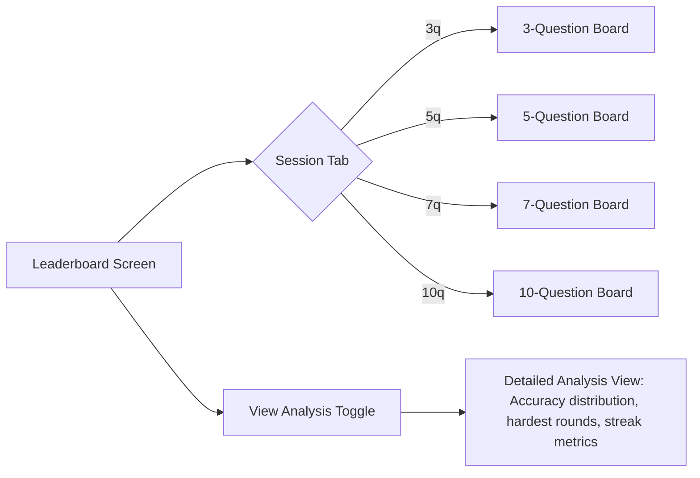

<div align="center">

# TuringWall

### An interactive kiosk Turing challenge and pattern-recognition game for the Daksh AIML stall

_Can you tell whether a piece of writing or art is human-crafted or AI-generated? 540+ curated rounds, offline-first kiosk reliability, multi-tier gameplay, and separate session leaderboards._

[](LICENSE)


[Quickstart](#quickstart) · [Features](#features) · [Architecture](#architecture) · [Methodology](./METHODOLOGY.md) · [Content Honesty](#item-bank--content-honesty) · [Game Mechanics](#game-mechanics--scoring) · [Stall Operations](#stall-operations--kiosk-mode) · [Testing & Simulation](#testing--simulation) · [Report an issue](https://github.com/ArrinPaul/TuringWall/issues)

</div>

---

## About

**TuringWall** (Real or AI?) is an interactive, kiosk-hardened web application built for the Daksh AIML stall. Visitors are invited to step up and test their critical reading against a curated gauntlet of 541 text passages and visual artifacts: discerning real human literature, commit messages, forum discussions, and artwork from the outputs of frontier generative models (GPT-4o, Claude 3.5, Gemini 1.5, Midjourney, Stable Diffusion).

Accompanying each player is **Signal**, an observant pattern-reading persona who provides instant feedback, highlights cognitive tells, and links rounds directly to an interactive 36-concept Field Guide.

The game is engineered from the ground up for unattended kiosk reliability:
- **Zero Network Reliance:** Runs 100% offline via local service worker caching and Web Audio tone synthesis once loaded.
- **Fair Leaderboards:** Independent, segregated leaderboards for each session length (3, 5, 7, and 10 questions) ensure a short run never unfairly competes against a marathon session.
- **Kiosk Self-Healing:** An automatic 45-second inactivity reset returns the app to the attract loop between visitors, while hardware-level double-click guards prevent erratic touch inputs.
- **Stall Export Tools:** Immediate one-click tab-separated `.txt` data exports for event coordinators and styled printable takeaway sheets for visitors.

**Who it's for:** Exhibition attendees, students, AI practitioners exploring synthetic media forensic markers, and developers seeking a reference architecture for offline-first, state-machine-driven kiosk software.

> **Kiosk & Offline Architecture:** This application requires **no external backend server or runtime internet connection** on the day of the event. All state, audio synthesis, randomization, and leaderboard persistence execute locally inside the browser. Read [METHODOLOGY.md](./METHODOLOGY.md) for full algorithmic details.

---

## Table of Contents

1. [About](#about)
2. [Features](#features)
3. [Item Bank & Content Honesty](#item-bank--content-honesty)
4. [Architecture](#architecture)
5. [Game Mechanics & Scoring](#game-mechanics--scoring)
6. [Tech Stack](#tech-stack)
7. [Quickstart](#quickstart)
8. [Stall Operations & Kiosk Mode](#stall-operations--kiosk-mode)
9. [Leaderboard & Analysis System](#leaderboard--analysis-system)
10. [Testing & Simulation](#testing--simulation)
11. [Scripts](#scripts)
12. [Project Structure](#project-structure)
13. [Security & Reliability](#security--reliability)
14. [Troubleshooting](#troubleshooting)
15. [Documentation](#documentation)
16. [Contributing](#contributing)
17. [License](#license)

---

## Features

| Area | What it does |
| :--- | :--- |
| **Attract Screen** | High-contrast, dynamic attract loop with live session statistics and sample round preview |
| **3-Step Setup Wizard** | Intuitive attendee onboarding: visitor name entry, difficulty tier selection, and question count |
| **Curated Question Bank** | 541 thoroughly verified items spanning human literature, historical letters, code, and frontier AI models |
| **Difficulty Tiers** | Novice, Keen, Expert, and Master modes calibrated for distinct skill curves, plus a Mixed deck option |
| **Signal Persona** | Real-time reactive avatar and commentary engine providing forensic insight after every guess |
| **Field Guide** | 36-concept pedagogical glossary explaining stylistic, structural, and cognitive AI tells |
| **Segregated Leaderboards** | Dedicated ranking tables for 3, 5, 7, and 10-question sessions so short and long runs never conflict |
| **Dedicated Analysis View** | In-depth performance diagnostics accessible via a toggle button on the `/leaderboard` screen |
| **Offline Audio Engine** | Pure Web Audio API tone synthesis for chimes and alerts with zero external asset latency |
| **Kiosk Watchdog** | 45-second idle detection loop that gracefully aborts abandoned games and resets to the attract screen |
| **Hardware Debounce Guard** | Rapid double-click protection ensuring physical touchscreen bounces do not submit double guesses |
| **Export & Takeaway** | One-click tab-separated `.txt` leaderboard export and CSS print-optimized visitor scorecards |

---

## Item Bank & Content Honesty

Educational games lose pedagogical value if the ground truth is ambiguous or hallucinated. Every round in **Real or AI?** is grounded in verified provenance:

| Category | Real Source | AI Generation Source | Integrity Assurance |
| :--- | :--- | :--- | :--- |
| **Prose & Fiction** | Public domain classics, contemporary literature, published anthologies | GPT-4o, Claude 3.5 Sonnet, Gemini 1.5 Pro | Human works verified against primary publications; AI text generated with documented prompt signatures |
| **Code & Technical** | Open-source GitHub repositories, real Git commits, bug reports | Frontier code generation models (Claude 3.5 Sonnet, GPT-4o) | Human code verified from commit hashes; AI code verified to replicate synthetic symmetry and documentation tells |
| **Casual & Conversational** | Verified historical letters, public forum posts, IRC logs | LLM roleplay prompts with casual system instructions | Real text verified from archival transcripts; AI text exhibits subtle emotional flatness or over-politeness |
| **Visual Art & Photos** | Public domain photography, studio art, origami (see [SOURCES.md](src/assets/images/SOURCES.md)) | Midjourney v6, Stable Diffusion XL | High-resolution assets with known licensing; AI images exhibit diffusion gloss, lighting quirks, or structural drift |

Full item schema and validation logic are enforced by automated test suites in `src/data/items.test.ts`.

---

## Architecture

```mermaid
flowchart TD
    subgraph UI Layer
        A[AttractScreen] --> W[Setup Wizard: Name · Tier · Length]
        W --> P[PlayingScreen]
        P --> R[RevealedPanel: Signal Feedback · Field Guide Tag]
        R --> S[StatsScreen: Final Score · Streak · Accuracy]
        S --> L[FullLeaderboard / Analysis View]
    end

    subgraph State & Logic
        Store[Zustand GameStore]
        Idle[Idle Watchdog Hook: 45s Reset]
        Audio[Web Audio Tone Synthesizer]
        FS[Native Fullscreen Handler: 'F' key]
    end

    subgraph Storage & Offline Cache
        SW[Service Worker Cache]
        LS[(Browser LocalStorage: 3q · 5q · 7q · 10q)]
    end

    P <--> Store
    Store --> Audio
    Idle --> Store
    FS --> UI Layer
    Store --> LS
    SW --> UI Layer
```

- **Single-Page Application (SPA):** Built with React 19, Vite, and Tailwind CSS 4 for instant screen transitions with zero page reloads.
- **Centralized State Machine:** Zustand store (`src/store/gameStore.ts`) manages active round indexes, score calculations, streak multipliers, and player answers.
- **Offline Resilience:** The Service Worker (`public/sw.js`) caches HTML, pre-bundled web fonts, and image assets on initial load.
- **Hardware Isolation:** Keyboard hotkeys (`F` for fullscreen, `M` for audio mute) and touch-friendly UI controls provide seamless kiosk management.

---

## Game Mechanics & Scoring

### Difficulty Tiers
- **Novice:** Obvious anomalies, exaggerated hallucinations, robotic phrasing, and heavy diffusion artifacts.
- **Keen:** Intermediate challenge; subtle syntactic balance, unnatural sentence cadence, and minor visual gloss.
- **Expert:** High-fidelity writing and art; nuanced reasoning, natural humor, and convincing photorealism.
- **Master:** Frontier Turing test; indistinguishable AI prose pitted against idiosyncratic human expression.
- **Mixed:** Dynamically drawn from across all difficulty tiers.

### Scoring Formula
Points are awarded for correct guesses based on tier difficulty and rewarded multiplicatively for consecutive streaks:

$$\text{Points} = \text{Base (100)} \times \text{TierMultiplier} \times \text{StreakMultiplier}$$

| Streak Count | Multiplier | Signal Feedback Level |
| :---: | :---: | :--- |
| **1 in a row** | $1.0\times$ | Neutral / Focused |
| **2 in a row** | $1.5\times$ | Attentive |
| **3 in a row** | $2.0\times$ | Enthusiastic |
| **4 in a row** | $2.5\times$ | Impressed |
| **5+ in a row** | $3.0\times$ | Masterful |

An incorrect answer resets the streak to zero. Accuracy is computed as $(\text{Correct} / \text{Total}) \times 100\%$.

---

## Tech Stack

| Layer | Technology | Purpose |
| :--- | :--- | :--- |
| **Core Framework** | React 19 (`react`, `react-dom`) | UI component hierarchy and rendering |
| **Build & Tooling** | Vite 8, TypeScript 5.8 | High-speed ESM bundling and strict type safety |
| **Styling** | Tailwind CSS 4 (`@tailwindcss/vite`) | Utility-first CSS styling and responsive layout |
| **Typography** | `@fontsource/fraunces`, `ibm-plex-mono`, `ibm-plex-sans` | Self-hosted serif and monospace font packages |
| **State Management** | Zustand 5 | Reactive game state machine and settings |
| **Motion & Confetti** | Framer Motion 14, Canvas Confetti 1.9 | Micro-interactions, slide reveals, and victory celebration |
| **Audio** | Native Web Audio API | Zero-dependency procedural sound synthesis |
| **Testing** | Vitest 5, Testing Library, jsdom | Unit, integration, and Monte Carlo simulation testing |
| **Offline & PWA** | Service Worker, Web App Manifest | Asset caching and offline installability |

---

## Quickstart

### Prerequisites
- **Node.js:** `v20.x` or newer (Node.js 22 LTS recommended)
- **Package Manager:** `npm`, `pnpm`, or `bun`

### Installation & Local Run

```bash
# 1. Clone the repository
git clone https://github.com/ArrinPaul/TuringWall.git
cd TuringWall

# 2. Install dependencies
npm install

# 3. Start local development server
npm run dev
```

Open `http://localhost:5173` (or the port displayed in your terminal) to explore the game.

To view the standalone leaderboard page directly during development:
```
http://localhost:5173/leaderboard
```

---

## Stall Operations & Kiosk Mode

### Before the Event (Preparation)
1. On the kiosk laptop while connected to the internet:
   ```bash
   npm install
   npm run build
   ```
2. Warm the offline cache: run `npm run preview`, open the app in Chrome, and play one quick session on **Mixed** difficulty to ensure all visual assets and fonts are cached in the browser's Service Worker.

### On the Day (Running Offline)
Start the pre-built local preview server (no internet connection required):
```bash
npm run preview
```
Open Chrome, navigate to the local address (e.g. `http://localhost:4173`), and prepare kiosk mode:
- **Go Fullscreen:** Click the **Fullscreen** button in the top-right corner (or press **`F`**). This hides browser tabs, bookmarks, and address bars.
- **Sound Check:** Press **`M`** to verify audio chimes are enabled or muted as preferred for stall noise levels.
- **Self-Healing:** If an attendee walks away mid-game, the app automatically resets to the attract screen after 45 seconds of idle time.

### End of Day Data Retrieval
1. Navigate to `/leaderboard` or click **Leaderboard** from the attract screen.
2. Click **Export .txt** to download a clean, tab-separated log of all completed runs for that session length (importable into Excel or Google Sheets).
3. Repeat for each session length tab (3q, 5q, 7q, 10q) if needed.
4. From any completed game's stats screen, click **Print takeaway** to open a clean, 1-page printable summary for attendees to take home.

---

## Leaderboard & Analysis System

The leaderboard is partitioned into dedicated tabs for **3, 5, 7, and 10 questions**:



- **Clean Leaderboard:** Shows rank, visitor name, tier badge, score, accuracy, streak, and timestamp.
- **Dedicated Analysis Toggle:** Click **`[View Analysis]`** to inspect performance metrics without cluttering the primary ranking board.
- **Direct Route Support:** Visiting `/leaderboard` directly navigates straight to the full scoreboard view.

---

## Testing & Simulation

The test suite consists of **16 test files** and **131 tests** covering unit behavior, component integration, and stress simulations:

```bash
# Run the complete test suite once
npm test -- --run

# Run in watch mode during development
npm test
```

### Simulation & Stress Suite (`src/game/simulation.test.ts`)
The test suite includes a 21-test simulation suite verifying:
- **10,000-Draw Monte Carlo Test:** Verifies that sequential deck generation across all difficulty tiers never throws out-of-bounds errors, yields `undefined` items, or duplicates questions within a round.
- **Touch Debounce Tests:** Validates that rapid-fire simultaneous clicks on guess buttons register exactly one answer.
- **State Integrity:** Confirms store state resets cleanly on game completion or idle watchdog triggers.

---

## Scripts

| Command | What it does |
| :--- | :--- |
| `npm run dev` | Starts Vite local development server with Hot Module Replacement (HMR) |
| `npm run build` | Compiles TypeScript (`tsc -b`) and bundles production assets with Vite |
| `npm run preview` | Serves the production `dist/` directory locally (ideal for kiosk deployment) |
| `npm test` | Runs the Vitest test runner (131 tests across 16 test suites) |
| `npm test -- --run` | Executes the Vitest test suite once and exits |
| `npm run lint` | Runs the high-speed Oxlint linter on codebase files |

---

## Project Structure

```text
TuringWall/
├── src/
│   ├── assets/               Local imagery, source licenses (SOURCES.md), icons
│   ├── audio/                Web Audio API tone synthesizer (tone.ts) and tests
│   ├── character/            Signal character persona, dialogue engine, and Field Guide
│   ├── components/           UI screens: Attract, Select Wizard, Playing, Reveal, Stats, Leaderboard
│   ├── data/                 Curated 541-item content bank (items.ts) and type schemas (types.ts)
│   ├── game/                 Deck dealing, Fisher-Yates shuffle, scoring logic, simulation tests
│   ├── hooks/                Fullscreen API hook and 45-second idle watchdog hook
│   ├── leaderboard/          LocalStorage leaderboard engine, export generators, sorting
│   ├── store/                Zustand central game store and state transitions
│   ├── App.tsx               Top-level application router and screen coordinator
│   ├── main.tsx              Application entry point and service worker registration
│   └── index.css             Tailwind CSS 4 styles and custom typography bindings
├── public/                   PWA manifest, service worker (sw.js), kiosk icons
├── dist/                     Production build output for standalone offline hosting
├── METHODOLOGY.md            Detailed scientific & algorithmic documentation
├── LICENSE                   MIT License
└── package.json              Project metadata and dependencies
```

---

## Security & Reliability

- **100% Client-Side:** No remote APIs, databases, or third-party tracking scripts are invoked during gameplay.
- **Content Sanitization:** Text content is rendered strictly via React DOM bindings to eliminate Cross-Site Scripting (XSS) vectors.
- **LocalStorage Quota Protection:** Leaderboard saves wrap writes in defensive `try/catch` blocks, maintaining an in-memory buffer if storage is unavailable or full.
- **Service Worker Reliability:** Static assets and self-hosted fonts are precached; broken image links fallback cleanly to styled visual placeholders instead of broken image icons.

---

## Troubleshooting

| Symptom | Likely Cause | Resolution |
| :--- | :--- | :--- |
| **App seems unresponsive** | Idle timer triggered or screen lost focus | Press `F5` or click anywhere on the screen to reload state cleanly. |
| **Fullscreen exited unexpectedly** | Attendee pressed `Esc` key on keyboard | Click the **Fullscreen** button in the top-right corner or press **`F`**. |
| **Sound is silent** | Browser audio autoplay blocked or muted | Click the **Sound** toggle in the header or press **`M`** to unmute. |
| **Images show placeholder icons** | Offline load occurred before cache warm-up | Run `npm run preview` online once, play a round on Mixed tier to cache all images, then disconnect. |
| **Leaderboard empty after restart** | Browser cookies / local data were cleared | LocalStorage is device-specific. Ensure kiosk browser data retention settings are enabled. |

---

## Documentation

| Document | Purpose |
| :--- | :--- |
| [METHODOLOGY.md](./METHODOLOGY.md) | In-depth breakdown of item curation, scoring formulas, deck math, and Signal heuristics |
| [src/assets/images/SOURCES.md](src/assets/images/SOURCES.md) | Licensing, provenance, and attribution details for all visual image assets |
| [public/manifest.webmanifest](public/manifest.webmanifest) | Web App Manifest configuration for standalone kiosk installation |

---

## Contributing

Contributions to improve the question bank, refine difficulty calibration, or enhance kiosk features are welcome!

1. Fork the repository and create a feature branch (`git checkout -b feat/new-items`).
2. If adding items to `src/data/items.ts`, ensure every entry includes verified ground truth, an explanation, difficulty tier, and a valid concept tag.
3. Run the complete test suite to ensure all 131 tests pass:
   ```bash
   npm test -- --run
   npm run build
   ```
4. Submit a Pull Request with a clear description of your changes.

---

## License

Released under the **MIT License**. See [LICENSE](LICENSE) for full legal text.
